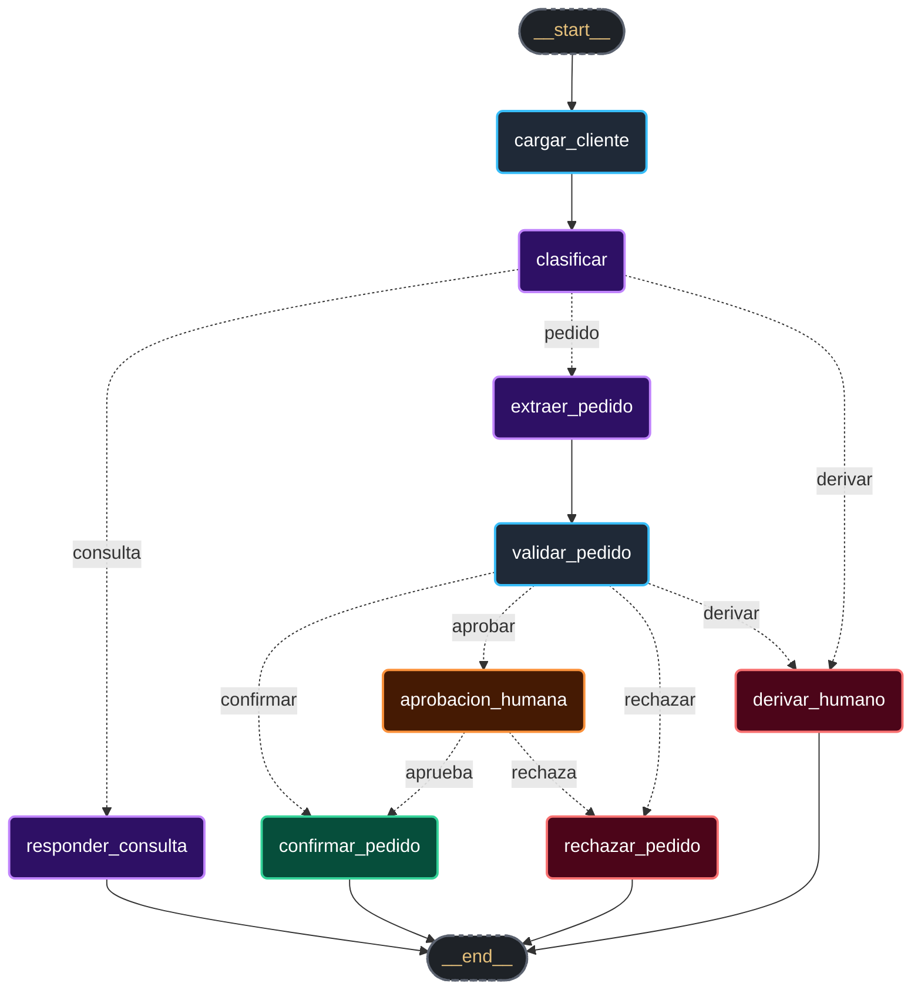

# Mesa de Pedidos — Desafío 1 (IA Engineering)

**Diplomatura Universitaria en IA Engineering** · ICARO · UNC · FCEFyN

Sistema inteligente de procesamiento y validación de pedidos para **Ferretería Industrial Andina S.R.L.** implementado con **LangGraph**, **RAG sobre políticas** y **validación determinística de reglas comerciales en Python**.

---

## 📌 1. ¿De qué se trata el sistema?

El sistema automatiza el procesamiento de mensajes que ingresan por WhatsApp o correo electrónico:
1. **Clasifica** la intención del mensaje: `consulta`, `pedido` o `derivar`.
2. **Responde consultas** buscando en las políticas de la empresa (4 documentos PDF) citando de forma verificable el **documento y la página**.
3. **Extrae pedidos** con *Structured Output* (Pydantic).
4. **Valida stock, precios, mora y crédito disponible** consultando bases de datos locales (`catalogo.csv` y `clientes.csv`) **sin delegar cálculos matemáticos al LLM**.
5. **Human-in-the-Loop (`interrupt`)**: Si el pedido excede el crédito, presenta mora o requiere descuentos especiales, frena el flujo, guarda el estado en SQLite y solicita aprobación o rechazo a Gerencia Comercial antes de confirmar.

---

## 🏛️ 2. Arquitectura del Grafo (LangGraph)

El flujo cuenta con 9 nodos, 3 routers condicionales y 5 hojas. Las flechas punteadas son aristas condicionales (su destino se conoce recién cuando se ejecuta):



**9 nodos · 3 routers · 5 hojas:**

| Nodo | Usa LLM | Qué hace |
|---|---|---|
| `cargar_cliente` | no | Resuelve el CUIT contra `clientes.csv` |
| `clasificar` | sí | Consulta / pedido / derivar (structured output con Pydantic) |
| `responder_consulta` | sí | RAG: recupera fragmentos de políticas y responde citando fuente |
| `extraer_pedido` | sí | Extrae ítems y cantidades del texto (structured output) |
| `validar_pedido` | **no** | Tools + reglas en Python: precio, descuento, crédito, stock → ruta |
| `aprobacion_humana` | no | `interrupt()`: frena y espera decisión de Gerencia |
| `confirmar_pedido` | redacta | Registra el pedido confirmado; el LLM solo redacta el mensaje |
| `rechazar_pedido` | redacta | Registra el rechazo; el LLM solo redacta el mensaje |
| `derivar_humano` | no | Genera ticket de derivación para atención humana |

---

## 📂 3. Estructura del Repositorio

```text
Mesa de Pedidos/
├── README.md                 este archivo
├── config.py                 rutas, modelos, parámetros del RAG y reglas de negocio
├── correr.py                 la consola CLI: procesa mensajes, frena y retoma
├── evaluar.py                evaluación automatizada contra el golden set
├── requirements.txt · .envmodelo · .gitignore
│
├── datos/                    los datos del enunciado, tal como vinieron
│   ├── politicas/*.pdf       el corpus del RAG (4 PDF, 10 páginas)
│   ├── catalogo.csv          40 productos
│   ├── clientes.csv          12 clientes
│   ├── bandeja.jsonl         los 20 mensajes de entrada
│   └── golden_set.json       la respuesta correcta de cada uno
│
├── mesa_pedidos/             el paquete
│   ├── esquemas.py           modelos de Pydantic (structured output y datos)
│   ├── datos.py              la única capa que abre archivos de datos
│   ├── reglas.py             la política comercial en funciones puras
│   ├── tools.py              las tools comerciales (@tool + args_schema)
│   ├── indexar.py            PDF → chunks por artículo → FAISS persistido
│   ├── recuperacion.py       retriever híbrido y armado de citas
│   ├── prompts.py            los prompts del sistema
│   ├── llm.py                fábrica del cliente de Google Gemini
│   ├── estado.py             el TypedDict con sus reducers
│   ├── nodos.py              los 9 nodos del grafo
│   ├── grafo.py              routers, cableado y checkpointer
│   ├── ejecucion.py          correr, frenar, retomar, listar pendientes
│   ├── utilidades.py         validación de CUIT, formato de moneda y texto
│   └── ver_modelos.py        diagnóstico de modelos y cuotas
│
├── tests/                    suite de pruebas con pytest (sin API)
│   ├── test_tools.py         catálogo, desempate y ambigüedad
│   ├── test_reglas.py        descuentos, mora, fletes y ruteo
│   ├── test_estado.py        EstadoMesa, reducers y compilación
│   ├── test_grafo.py         topología de 9 nodos y 3 routers
│   └── test_ejecucion.py     frenado, SQLite y reanudación
│
└── docs/                     documentación y entrega
    ├── CONSIGNA.md           enunciado original
    ├── GUIA_CURADA.md        manual de estudio y bitácora técnica
    ├── INFORME_FINAL.*       informe de entrega académica (md, pdf, docx)
    └── grafo.md              diagrama y topología del grafo
```

---

## ⚙️ 4. Puesta en Marcha

### Prerrequisitos
- Python 3.10+ en Windows.
- Clave de API de Google Gemini (o de OpenAI opcional).

### Instalación paso a paso

1. **Crear y activar el entorno virtual:**
   ```powershell
   py -m venv .venv
   .\.venv\Scripts\Activate.ps1
   ```

2. **Instalar dependencias:**
   ```powershell
   .\.venv\Scripts\python.exe -m pip install -r requirements.txt
   ```

3. **Configurar variables de entorno:**
   Copia la plantilla `.envmodelo` a un nuevo archivo `.env` y coloca tu API Key:
   ```powershell
   copy .envmodelo .env
   ```
   Dentro de `.env`:
   ```env
   GOOGLE_API_KEY=tu_clave_real_aqui
   ```
   *(Nota de seguridad: el archivo `.env` está estrictamente ignorado en `.gitignore` para no filtrar credenciales).*

---

### 💡 Gestión de Cuotas y Modelos en Google AI Studio (Free Tier vs. Paga)

Google actualiza frecuentemente las cuotas diarias y los nombres de los modelos en su API. Para verificar exactamente cuántas peticiones tenés disponibles en tu proyecto:

👉 **Consultar cuotas en tu cuenta:** [Panel de Rate Limits en Google AI Studio](https://aistudio.google.com/app/rate-limit)

| Tarea | Modelo API | Equivalente en Dashboard | Cuenta Paga | Capa Gratuita (Free Tier) |
|---|---|---|---|---|
| **Embeddings (RAG)** | `models/gemini-embedding-001` | `Gemini Embedding 1` / `2` | Ilimitado | **100 RPM** · **1.000 RPD** |
| **LLM (Cuenta Paga)** | `gemini-3.8-flash` | Gemini 3.8 Flash | Ilimitado | *(Limitado a 20 RPD)* |
| **LLM (Capa Gratuita)** | `gemini-3.1-flash-lite` | Flash Lite | Ilimitado | **15 RPM** · **500 RPD** (recomendado para tests) |

**Recomendaciones para configurar según tu tipo de cuenta:**
- **Cuenta Paga (Pay-as-you-go):** Configurar `MODELO_LLM = "gemini-3.8-flash"` y `MODELO_EMBEDDINGS = "models/gemini-embedding-001"` en `config.py`.
- **Cuenta Gratuita (Free Tier):** Elegir en `config.py` un modelo de texto con alto cupo diario como `gemini-3.1-flash-lite` (500 RPD), ya que modelos como 3.8 Flash tienen un tope de 20 consultas por día y se agotan antes de terminar los 20 casos de prueba del Golden Set.
- **Herramienta de diagnóstico:** Ejecutá `.\.venv\Scripts\python.exe -m mesa_pedidos.ver_modelos` en cualquier momento para ver la lista exacta de modelos activos con tu clave.

---

## 🎛️ 5. Configuración del Proyecto (`config.py`)

Todo lo relativo a modelos, rutas y reglas de negocio vive centralizado en `config.py`:

- **Proveedor y Modelos Activos:**
  - Proveedor activo: `PROVEEDOR = "google"` (respaldo disponible para `"openai"`).
  - LLM: `gemini-3.8-flash` (cuenta paga) o `gemini-3.1-flash-lite` (cuenta gratuita, 500 RPD), con `temperatura: 0.0`.
  - Embeddings: `models/gemini-embedding-001` (100 RPM / 1.000 RPD).
- **RAG de Políticas:**
  - Estrategia de chunking: `articulos` (59 chunks estructurados por artículo y SKU, preservando excepciones legales).
  - Búsqueda: Híbrida (`rank-bm25` con peso 0.4 + denso en FAISS con peso 0.6).
- **Reglas Comerciales Determinísticas (Python puro):**
  - Pedidos mínimos por zona: Zona A ($250.000), Zona B ($250.000), Zona C ($120.000).
  - Escala de descuentos por volumen y tope estricto del 15% en herramientas eléctricas (Dewalt, Makita, Bosch).
  - Bonificación financiera por pago anticipado: 3% (opera fuera del tope).
  - Días de mora: 30 a 60 días requiere autorización gerencial; >60 días cuenta suspendida (solo habilitado con pago anticipado).

---

## 🧪 6. Ejecución, Pruebas y Métricas

Todas las ejecuciones deben realizarse con el entorno virtual activo:

### 1. Pruebas Unitarias (Sin costo de API)
Verifican el 100% de la lógica determinística de negocio en milisegundos:
```powershell
.\.venv\Scripts\python.exe -m pytest -v
```

### 2. Indexación de Políticas (RAG)
Genera el índice vectorial FAISS a partir de los 4 documentos PDF (se persiste en disco):
```powershell
.\.venv\Scripts\python.exe -m mesa_pedidos.indexar
```
*Para inspeccionar los 59 chunks generados sin llamar a la API:*
```powershell
.\.venv\Scripts\python.exe -m mesa_pedidos.indexar --ver
```

### 3. Procesamiento y Consola Interactiva (`correr.py`)
| Comando | Qué hace |
|---|---|
| `.\.venv\Scripts\python.exe correr.py --mensaje MSG-009` | Procesa un pedido estándar: valida y confirma automáticamente. |
| `.\.venv\Scripts\python.exe correr.py --mensaje MSG-013` | Pedido que supera el crédito: se frena en `interrupt()` y guarda checkpoint. |
| `.\.venv\Scripts\python.exe correr.py --pendientes` | Lista todos los pedidos frenados esperando decisión de Gerencia. |
| `.\.venv\Scripts\python.exe correr.py --mensaje MSG-013 --decision aprobar --razon "Autorizado"` | Reanuda el hilo en SQLite y confirma el pedido. |
| `.\.venv\Scripts\python.exe correr.py --texto "Cuánto sale el flete a Salta?" --cuit 30-71455982-2` | Procesa una consulta informal escrita a mano. |
| `.\.venv\Scripts\python.exe correr.py --todos` | Procesa en lote los 20 mensajes de `bandeja.jsonl`. |
| `.\.venv\Scripts\python.exe correr.py --grafo` | Imprime el diagrama del grafo en sintaxis Mermaid. |

### 4. Evaluación Formal contra el Golden Set (`evaluar.py`)
Mide el rendimiento integral del sistema contra los 20 casos de prueba de referencia:
```powershell
.\.venv\Scripts\python.exe evaluar.py
```

Resultados consolidados de la evaluación benchmark:
```text
==========================================================================================
METRICAS GLOBALES DEL BENCHMARK (20 CASOS - GOLDEN SET):
  1. Ruteo Correcto:           20/20 (100.0%)
  2. Consultas con Dato Clave:   8/8 (100.0%)
  3. Intencion Correcta:       20/20 (100.0%)
  4. Documento Correcto:         8/8 (100.0%)
  5. Extraccion de Items:      Precision: 1.000 | Recall: 1.000
==========================================================================================
```

El reporte estructurado se persiste automáticamente en:
* `artefactos/salidas/evaluacion.json` (reporte estructurado oficial de entrega).
* `artefactos/salidas/evaluacion_hibrido.json` (versión con detalle técnico del retriever).

Para un análisis detallado de la arquitectura, decisiones de diseño, casos de estudio y justificación teórica, consultar el **Informe Final de Entrega** en:
👉 [docs/INFORME_FINAL.pdf](docs/INFORME_FINAL.pdf)
