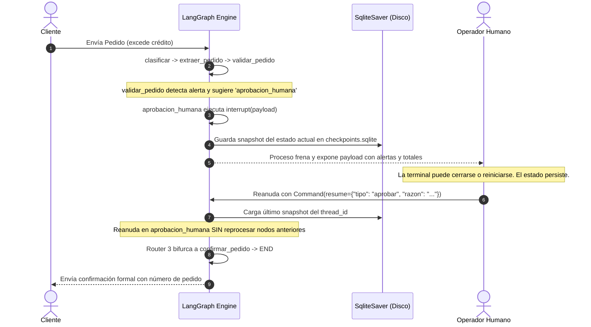

# 📓 Cuaderno de Ingeniería: Mesa de Pedidos
**Diplomatura en IA Engineering (ICARO · UNC · FCEFyN)**
*Sistema inteligente de atención, validación comercial y ruteo con LangGraph, RAG y Human-in-the-Loop.*

---

## 🧭 1. Introducción y Fundamentos del Proyecto

### ¿Qué problema resolvemos?
En una distribuidora industrial (*Ferretería Industrial Andina S.R.L.*), los clientes se comunican por canales no estructurados (WhatsApp, correos) enviando:
1. **Consultas sobre políticas** (fletes por zona, garantías de máquinas, medios de pago, bonificaciones).
2. **Pedidos de mercadería** (mezclando descripciones coloquiales, marcas, cantidades).
3. **Casos especiales** (reclamos airados, cancelaciones, solicitudes de cuentas corrientes).

### El gran error de la IA tradicional vs. IA Engineering
Un error común en principiantes es pedirle a un LLM:
> *"Lee el catálogo, valida el stock, calcula el límite de crédito con la tasa de descuento y confírmame el pedido"*.

Esto **falla en producción** por tres razones:
1. **Alucinación matemática:** Los LLMs no son calculadoras; predicen el siguiente token estadísticamente. Confiarles sumas, porcentajes y límites crediticios produce errores financieros graves.
2. **Falta de determinismo:** Las reglas de negocio (mora >30 días requiere autorización, marcas con tope del 15% de descuento) deben ser 100% predecibles y auditables.
3. **Problema de contexto (Context Window y Ruidos):** Inyectar miles de líneas de catálogos y políticas en cada prompt es lento, costoso y propenso a omitir cláusulas finas.

### Los Tres Pilares de Nuestra Arquitectura
1. **LLM solo para tareas de Lenguaje Natural:**
   - Clasificar la intención del cliente (`consulta`, `pedido`, `derivar`).
   - Extraer items estructurados a partir de texto informal (*Structured Output* con Pydantic).
   - Redactar respuestas a consultas citando fuentes explícitas del RAG.
2. **Python Puro para Lógica de Negocio (Tools Determinísticas):**
   - Stock, precios de lista, límites de crédito, análisis de mora y cálculo de fletes se ejecutan en código Python exacto.
3. **Orquestación con LangGraph y Human-in-the-Loop:**
   - Modelamos el flujo como una máquina de estados finita (grafo dirigido cíclico/acíclico).
   - Si un pedido excede el crédito o el cliente presenta mora, el grafo **guarda su estado en SQLite y se frena** (`interrupt()`) esperando la decisión de un supervisor humano, que luego reanuda el proceso (`resume`).

---

## 📁 2. Fase 0: Estructura Modular y Configuración Centralizada

### Organización de Carpetas
```text
Mesa de Pedidos/
├── datos/                  <- Datos de entrada del negocio
│   ├── politicas/          <- 4 PDFs de políticas corporativas (corpus para RAG)
│   ├── catalogo.csv        <- 40 productos con SKU, descripción, precio, stock
│   ├── clientes.csv        <- 12 clientes con CUIT, límite, saldo, mora
│   ├── bandeja.jsonl       <- 20 mensajes reales para simulación
│   └── golden_set.json     <- Casos de prueba para evaluación
├── mesa_pedidos/           <- Paquete de Python del sistema
│   ├── __init__.py
│   ├── indexar.py          <- (Fase 1) Ingesta, chunking y vectorización de PDFs
│   ├── recuperacion.py     <- (Fase 1) Búsqueda vectorial/híbrida y LLM con citas
│   ├── tools.py            <- (Fase 2) Funciones comerciales determinísticas
│   ├── esquemas.py         <- (Fase 3) Modelos Pydantic para Structured Output
│   ├── estado.py           <- (Fase 3) TypedDict y reducers de LangGraph
│   ├── nodos.py            <- (Fase 3) Los 9 nodos del grafo
│   └── grafo.py            <- (Fase 4) Ensamblado de nodos, routers y SqliteSaver
├── artefactos/             <- Directorio de salidas generadas (ignorado en git)
│   ├── indice_faiss/       <- Índice vectorial persistido
│   └── checkpoints.sqlite  <- Base de persistencia de LangGraph
├── config.py               <- Archivo único de verdad (rutas, modelos, reglas)
├── correr.py               <- Script CLI para procesar mensajes e interactuar
└── evaluar.py              <- Suite de evaluación contra Golden Set
```

### ¿Por qué centralizar en `config.py`?
- **Evitar magic numbers y hardcoding:** Valores como `PEDIDO_MINIMO = {"A": 250_000, "B": 250_000, "C": 120_000}` o `MORA_AUTORIZACION_DIAS = 30` están en un solo lugar. Si la empresa cambia una política comercial, se ajusta aquí sin tocar el grafo ni los prompts.
- **Flexibilidad de proveedores:** Permite cambiar fácilmente entre Google Gemini y OpenAI.
- **Rutas seguras con `pathlib.Path`:** Resuelve rutas absolutas independientes del directorio desde el que se invoque el comando en Windows o Linux.

---

## 🔍 3. Fase 1: RAG de Políticas y Citación Verificable

### Conceptos Clave
1. **¿Qué es RAG (Retrieval-Augmented Generation)?**
   En lugar de entrenar o hacer fine-tuning al modelo con los documentos de la empresa, RAG busca los fragmentos pertinentes en tiempo real y se los pasa al LLM como contexto en el prompt.

2. **Chunking por Artículos vs. Chunking Fijo:**
   - *Chunking fijo (por caracteres o tokens):* Corta arbitrariamente cada 500 caracteres con un solapamiento (overlap). En documentos legales o políticas, esto puede cortar un artículo por la mitad, separando la regla de su excepción.
   - *Chunking por Artículos (Estructural):* Detecta expresiones como `Artículo 1°`, `Artículo 2°` o secciones temáticas. Cada chunk es una unidad semántica autosuficiente.

3. **Embeddings (`models/text-embedding-004`):**
   Convierten fragmentos de texto en vectores matemáticos de alta dimensión (768 dimensiones). Textos con significados conceptualmente similares quedan cerca en el espacio vectorial.

4. **FAISS (Facebook AI Similarity Search):**
   Una librería ultra eficiente en C++ (con bindings para Python) para realizar búsquedas por similitud de cosenos o producto interno a escala.

5. **Búsqueda Híbrida (Dense + Sparse con BM25):**
   - **Embeddings densos:** Capturan la semántica general ("¿cómo me envían las cosas?" -> busca "fletes y logística").
   - **BM25 (Sparse / Léxico):** Busca palabras clave exactas y códigos específicos (por ejemplo: "Zona B", "garantía de 12 meses", "SKU").
   - La combinación ponderada de ambos evita que el modelo pierda detalles específicos mientras conserva la flexibilidad del lenguaje natural.

6. **Citación Verificable (Anti-Alucinaciones):**
   El prompt del RAG exige al modelo:
   - Contestar **únicamente** con la información presente en el contexto.
   - Incluir la cita en formato: `[Nombre del Documento, Página X]`.
   - Si la información no se encuentra en las políticas, indicar explícitamente que no está disponible y sugerir consultar a un operador humano.

### Implementación del Módulo de Indexación (`mesa_pedidos/indexar.py`)
El archivo implementa las tres etapas fundamentales:
1. `cargar_paginas()`: Recorre `datos/politicas/*.pdf` con `PyPDFLoader`, asignando a cada página su documento y número de página normalizado (base 1).
2. `partir_en_chunks()`:
   - Filtra encabezados ("FERRETERÍA INDUSTRIAL ANDINA...") y pies repetitivos.
   - Agrupa el contenido por artículo (`ART. \d+ - `), punto numerado (`\d+\. TITULO`) o SKU (`HE-4330`).
   - Concatena el título formal al inicio del chunk (`Condiciones Comerciales 2026 | ART. 4...`).
   - Aplica una red de seguridad con `RecursiveCharacterTextSplitter` solo si algún artículo supera los 1200 caracteres.
3. `construir_indice()`:
   - Calcula una huella digital (`_huella()`) con los hashes SHA-256 de los 4 PDFs y los parámetros de configuración.
   - Si el índice ya existe y la huella coincide, lo carga al instante desde disco (`FAISS.load_local`) sin consumir cuota de API.
   - Si cambió algo o no existe, genera los embeddings mediante Google Gemini (`models/text-embedding-004`) o OpenAI, crea el vectorstore y lo persiste en `artefactos/indice_faiss/` junto a `manifiesto.json`.

### 🔬 Metodología de Validación del Chunking (El Caso Crítico MSG-003)
¿Cómo sabe un Ingeniero de IA que el particionado no tiene fallos sin leer todos los fragmentos a mano?
1. **Suma de Control Estructural:**
   - 9 artículos en condiciones comerciales.
   - 40 fichas de productos (SKUs).
   - 5 puntos en logística.
   - 5 puntos en devoluciones y garantías.
   - **Total exacto esperado:** $9 + 40 + 5 + 5 = 59\text{ chunks}$. Ni un fragmento huérfano ni fusiones espurias.
2. **Prueba de Excepciones Legales (Edge Case MSG-003):**
   - El mensaje MSG-003 de la bandeja pregunta si un cliente puede devolver zapatos de seguridad por arrepentimiento.
   - Si se usa un splitter recursivo estándar por longitud fija (ej: 900 caracteres), la regla general (*"Se aceptan devoluciones dentro de los 15 días"*) cae en un chunk y la lista de exclusiones (*"NO se aceptan devoluciones de elementos de protección personal: guantes, zapatos de seguridad..."*) cae en el siguiente chunk. El LLM respondería afirmativamente con total elocuencia, cometiendo un error costoso.
   - **Verificación:** El chunk `[56]` (`politica_devoluciones_2026.pdf | Sección: 2. DEVOLUCION POR ARREPENTIMIENTO`) tiene 642 caracteres y reúne ambas partes inseparables en una sola ventana de contexto.
3. **Control de Densidad Semántica:**
   - Todos los chunks se ubican entre 150 y 808 caracteres, rango óptimo para evitar tanto la pérdida de contexto (chunks microscópicos) como la dilución de la señal vectorial (chunks kilométricos).

### 💡 Gestión de Cuotas en Google AI Studio (Free Tier vs. Paga)
Para chequear los límites en tiempo real de tu cuenta:
👉 [Panel de Rate Limits en Google AI Studio](https://aistudio.google.com/app/rate-limit)

1. **Embeddings:** El modelo activo es **`models/gemini-embedding-001`** (en dashboard: *Gemini Embedding 1 / 2*), con **100 RPM** y **1.000 RPD** en la capa gratuita. Cubre holgadamente los 59 chunks del índice en una sola corrida.
2. **LLM para Cuenta Paga:** `gemini-3.8-flash` (sin límites diarios).
3. **LLM para Cuenta Gratuita:** Seleccionar en `config.py` un modelo con alto cupo diario como `gemini-3.1-flash-lite` (500 RPD y 15 RPM). Evitar usar modelos con tope de 20 RPD (como el 3.8 en free tier) porque no alcanzan a procesar los 20 casos de prueba del Golden Set.
4. **Herramienta de diagnóstico:** Ejecutar `py -m mesa_pedidos.ver_modelos` para inspeccionar los modelos disponibles de cualquier API key.

### Implementación del Módulo de Recuperación y Citas (`mesa_pedidos/recuperacion.py`)
1. **Tokenizador BM25 con preservación de SKUs:**
   `re.findall(r"[a-z]{2}-\d{4}|[a-z0-9]+", normalizar_texto(texto))` asegura que códigos como `HE-4330` o `¿HE-4330?` se capturen como el token limpio `he-4330`.
2. **MMR (Maximal Marginal Relevance) en FAISS:**
   `fetch_k=20`, `k=4`, `lambda_mult=0.5`. Evita que el retriever traiga cuatro fragmentos redundantes que dicen lo mismo, diversificando la información para el LLM.
3. **EnsembleRetriever:**
   Combina BM25 (0.4) y FAISS denso (0.6) aplicando Reciprocal Rank Fusion (RRF).
4. **Citación Verificable:**
   El modelo devuelve el esquema Pydantic `RespuestaConsulta(respuesta=..., fuentes=[1, 2], encontrado=True)`. La función `citas_desde_fuentes()` toma esos enteros y busca los metadatos reales del documento (`documento`, `pagina`), garantizando cero alucinaciones de archivos o páginas inexistentes.

---

## 🏛️ 4. Principios y Buenas Prácticas de Ingeniería con LangGraph

Para asegurar la robustez, auditabilidad y mantenibilidad del sistema en un entorno productivo, se adoptan los siguientes principios de arquitectura:

### 1. Enrutamiento Declarativo vs. Ramificaciones Ocultas
El ruteo entre estados de negocio no debe resolverse mediante bifurcaciones condicionales (`if`/`else`) ocultas dentro del cuerpo de los nodos. Toda transición de flujo se modela como **aristas condicionales explícitas** en el grafo de LangGraph. Los nodos ejecutan su lógica especializada y devuelven estado; las funciones *router* operan como pasamanos puros que leen el estado y determinan el siguiente nodo destino. Esto permite una auditoría clara y la generación transparente del diagrama arquitectónico.

### 2. Persistencia Transaccional de Estados (Human-in-the-Loop)
El patrón de interrupción interactiva con `interrupt()` requiere indispensablemente un mecanismo de persistencia transaccional duradera (`SqliteSaver` sobre `artefactos/checkpoints.sqlite`). Esto garantiza la tolerancia a fallos: el proceso puede pausarse, cerrar la sesión y ser reanudado de forma asíncrona por un operador humano mediante `Command(resume=...)` utilizando el `thread_id` del mensaje como clave de correlación.

### 3. Desarrollo Guiado por Evaluación Cuantitativa (Eval-Driven Development)
Ningún cambio en la ingeniería de prompts o en la heurística de recuperación debe validarse por intuición. Toda modificación se mide objetivamente contra el dataset de referencia (`golden_set.json`), monitoreando las dos métricas formales del proyecto: tasa de acierto de rama y precisión de extracción de datos clave.

### 4. Construcción y Verificación Incremental
El sistema se desarrolla siguiendo un orden de dependencia estricto: datos -> tools y reglas determinísticas -> esquemas estructurados -> nodos aislados -> grafo ensamblado. Cada componente se prueba exhaustivamente de forma unitaria antes de avanzar al siguiente, evitando la acumulación de deuda técnica.

---

## 🛠️ 5. Fase 2: Tools Comerciales y Tolerancia a Fallos en Python Puro

### Conceptos Clave
1. **Separación Estricta de Responsabilidades (Cero Alucinación Financiera):**
   - El LLM nunca calcula sumas, porcentajes ni saldos. Toda la interacción con catálogos y cuentas corrientes se encapsula en funciones determinísticas de Python.
2. **Anatomía de una Tool en LangChain (`@tool` + `args_schema`):**
   - Decorador `@tool`: Expone la interfaz `BaseTool` ejecutable con `.invoke(...)`.
   - `args_schema` (Pydantic): Valida fuertemente tipos de entrada antes de ejecutar la función.
   - `docstring`: Documenta el propósito de la herramienta para que un LLM o agente sepa cuándo utilizarla.
   - Las tools **informan datos duros, no deciden ruteo comercial**.

### Tolerancia a Fallos y Manejo de Ambigüedad (`consultar_producto`)
En canales conversacionales (WhatsApp), los clientes no siempre usan códigos exactos:
- **Tolerancia a Errores Tipográficos (Typo Tolerance):**
  Si el SKU no existe exactamente, se evalúa la cercanía de caracteres con `difflib.get_close_matches` usando un umbral (`cutoff`) del **75%**. Si el error es leve (ej: `AB-1021` vs `AB-1020`), se retorna como sugerencia sin cambiarlo a ciegas. Si la similitud es menor al 75%, se rechaza sin inventar.
- **Resolución por Especificación Técnica:**
  Una búsqueda como *"amoladora angular 115"* identifica con precisión `HE-4110` (115 mm) y descarta `HE-4180` (230 mm) gracias a la tokenización y coincidencia exacta de la medida.
- **Detección Automática de Ambigüedad (Empates de Máximo Puntaje):**
  Si dos o más productos empatan con la mejor puntuación posible (incluso coincidencia 3 de 3 o 2 de 2, como *"amoladora angular"* o *"guante ombu"*), la tool devuelve `encontrado: False` y `ambiguo: True` junto a las opciones candidatas. El sistema **jamás adivina**: eleva la decisión al operador humano en el nodo de aprobación.

### Políticas de Crédito y Riesgo (`verificar_credito`)
- **Límite:** `saldo_actual + pedido` no debe superar `limite_credito`. Si lo supera, requiere autorización gerencial.
- **Mora Leve (30 a 60 días):** Requiere autorización de Gerencia (Art. 7).
- **Mora Grave (>60 días o suspendido):** Inhabilitado en cuenta corriente. Solo habilitado si abona de forma anticipada (`pago_anticipado=True`).

---

## 🏛️ 6. Matriz de Decisiones de Arquitectura (Consenso de Diseño)

A partir de la exploración del código y de las pruebas del sistema de referencia, dejamos formalmente asentadas las 6 decisiones críticas del proyecto:

| Dimensión | Decisión Acordada | Justificación Técnica |
|---|---|---|
| **Estrategia de Chunking** | Semántico por Artículos y SKUs (`_chunks_por_articulo`) | Evita la fragmentación arbitraria. Mantiene las excepciones y listas de exclusión (ej. calzado de seguridad en devoluciones) unidas a sus reglas principales. Genera 59 chunks estructurados. |
| **Generación de Citas** | Índices numéricos del LLM traducidos por Python | El LLM solo devuelve `fuentes: [1, 3]`; Python lee los metadatos reales del chunk (`documento`, `pagina`). Imposibilita alucinaciones de archivos o páginas inexistentes. |
| **Lógica Comercial** | Funciones puras determinísticas en `reglas.py` | La matemática, las escalas de descuento por volumen, los topes por marca (15% en herramientas eléctricas) y el cálculo de crédito no se delegan al LLM. Routers del grafo operan como pasamanos de estado. |
| **Diseño Human-in-the-Loop** | Evitar la doble ejecución de `interrupt()` | Como LangGraph reinicia el nodo desde la primera línea al reanudar el checkpoint, solo se ubica lectura del payload arriba de `interrupt()`. Las validaciones con Pydantic y posibles recálculos corren abajo. Si la decisión es inválida, se rechaza por defecto. |
| **Evaluación del Golden Set** | Registro previo de interrupción (`hubo_interrupt`) | Al evaluar el Golden Set, se registra si el grafo se frenó en `aprobacion_humana` *antes* de reanudar, garantizando que el sistema sea evaluado por saber cuándo pedir aprobación. |
| **Recuperación RAG** | Híbrida ponderada (0.4 BM25 / 0.6 Denso) | BM25 con tokenizador regex preserva códigos técnicos enteros (ej. `he-4330`) y normaliza tildes; el denso captura similitud semántica y paráfrasis. |

---

## 🏛️ 7. Fase 4: Los 9 Nodos, Routers Condicionales y Orquestación del Grafo

### Principios Fundamentales del Grafo en LangGraph

1. **Responsabilidad Única y Atomicidad:**
   Cada nodo es una función aislada que recibe `state: EstadoMesa` y devuelve únicamente las claves calculadas o modificadas. LangGraph se encarga de mezclar ese diccionario en el estado global.
2. **Prohibición de Bifurcaciones Internas (Sin 'if' Ocultos):**
   Los nodos no deciden a qué nodo saltar a continuación. Toda transición condicional se modela externamente en el grafo mediante una **arista condicional** compuesta por:
   - Una **función router** (pasamanos puro que lee el estado y retorna una etiqueta textual).
   - Un **mapa de rutas** (`{"etiqueta": "nombre_nodo_destino"}`).
3. **Persistencia Transaccional (`SqliteSaver`):**
   El soporte para `interrupt()` requiere persistencia en base de datos SQLite (`artefactos/checkpoints.sqlite`). Esto garantiza que cuando el proceso se frena para supervisión humana, el estado no se pierde al cerrar la consola y puede retomarse asíncronamente con `Command(resume=...)`.

### Anatomía Técnica de los 9 Nodos

| # | Nodo | Naturaleza | Lee del Estado | Escribe en el Estado | Rol en el Sistema |
|---|---|---|---|---|---|
| **1** | `cargar_cliente` | Python puro (sin LLM) | `cuit` | `cliente`, `errores`, `log` | Busca la ficha en `clientes.csv`. Si no existe, anota el error sin arrojar excepción. |
| **2** | `clasificar` | LLM + Guardrails Python | `texto`, `cliente` | `clasificacion`, `intencion`, `log` | Determina intención (`consulta`/`pedido`/`derivar`) con Pydantic y aplica guardrails de confianza y CUIT registrado. |
| **3** | `responder_consulta` | RAG + Citación | `texto`, `cliente`, `fecha` | `respuesta`, `citas`, `fragmentos`, `ruta`, `log` | Recupera políticas (híbrido BM25 + FAISS), precalcula flete/volumen en Python y cita fuentes fidedignas. |
| **4** | `extraer_pedido` | LLM + Pydantic | `texto` | `pedido`, `log` | Extrae ítems, cantidades, pago anticipado y destino a partir de texto informal. Cero matemática. |
| **5** | `validar_pedido` | Python puro (CERO LLM) | `cliente`, `pedido` | `validacion`, `log` | Cruza con `catalogo.csv`, calcula precios/topes, valida crédito/mora y cotiza fletes determinísticamente. |
| **6** | `aprobacion_humana` | Human-in-the-Loop | `validacion`, `cliente`, `texto` | `decision_humana`, `validacion` (si edita), `log` | Frena con `interrupt(payload)` y al retomar procesa la decisión de Gerencia Comercial. |
| **7** | `confirmar_pedido` | Python + Redacción LLM | `validacion`, `cliente`, `decision_humana` | `resumen`, `respuesta`, `ruta`, `log` | Emite `ResumenPedido` confirmado, persiste en disco y redacta mensaje formal de confirmación. |
| **8** | `rechazar_pedido` | Python + Redacción LLM | `validacion`, `cliente`, `decision_humana` | `resumen`, `respuesta`, `ruta`, `log` | Emite `ResumenPedido` rechazado, persiste en disco y redacta mensaje diplomático con alternativa. |
| **9** | `derivar_humano` | Python puro (sin LLM) | `clasificacion`, `validacion`, `cliente` | `ticket`, `respuesta`, `ruta`, `log` | Emite `Ticket` numerado asignado al sector correspondiente y genera respuesta de contacto. |

### Los 3 Routers Oficiales (Pasamanos Puros)

```python
def ruta_por_intencion(state: EstadoMesa) -> str:
    # Lee state["intencion"] -> 'consulta' | 'pedido' | 'derivar'
    return state.get("intencion") or "derivar"

def ruta_por_validacion(state: EstadoMesa) -> str:
    # Lee state["validacion"]["ruta"] -> 'confirmar_pedido' | 'aprobacion_humana' | 'rechazar_pedido' | 'derivar_humano'
    return (state.get("validacion") or {}).get("ruta") or "derivar_humano"

def ruta_post_aprobacion(state: EstadoMesa) -> str:
    # Lee state["decision_humana"]["tipo"] -> 'confirmar' | 'rechazar'
    tipo = (state.get("decision_humana") or {}).get("tipo")
    return "confirmar" if tipo in ("aprobar", "editar") else "rechazar"
```

---

## 🛑 6. Fase 5: Human-in-the-Loop (HITL) y Consola CLI

### ¿Por qué Human-in-the-Loop en IA Engineering?
En un sistema comercial real, ningún modelo de lenguaje ni script automático debe autorizar por sí solo operaciones de alto riesgo crediticio o financiero. Cuando un pedido supera el límite de crédito o el cliente registra mora comercial superior a 30 días, el sistema debe pausar su ejecución y requerir la supervisión de un operador humano calificado (Gerencia Comercial).

LangGraph provee soporte nativo de primer nivel para este patrón a través de la primitiva `interrupt()`.

### El Ciclo de Vida de `interrupt()` y `Command(resume=...)`



### Conceptos Clave de Arquitectura:

1. **`thread_id` (Aislamiento de Conversaciones):**
   - Formato: `f"mensaje-{mensaje_id}"` (ej: `mensaje-MSG-013`).
   - Cada mensaje de la bandeja posee su propio hilo en el checkpointer.
   - Permite que el sistema procese mensajes en paralelo y retome exactamente el hilo correcto sin mezclar clientes ni carritos.

2. **Durabilidad Transaccional (`SqliteSaver`):**
   - Los checkpoints se persisten en `artefactos/checkpoints.sqlite`.
   - Si el operador apaga la máquina o cancela con `Ctrl+C`, la corrida queda en pausa. Al volver a ejecutar `py correr.py --mensaje MSG-013`, el sistema detecta que el hilo estaba pausado y lo retoma sin consumir llamadas adicionales al LLM en `clasificar` o `extraer_pedido`.

3. **Anatomía del Snapshot y Detección de Pausa:**
   - `snapshot = grafo.get_state(config)`:
     - `snapshot.next`: Tupla con los nodos que restan ejecutar. Si no está vacía al terminar la corrida, el grafo está frenado.
     - `snapshot.tasks[i].interrupts`: Lista de interrupciones activas. `interrupt.value` contiene el diccionario con los datos del pedido que Gerencia Comercial necesita ver.

4. **Prevención de Deadlocks en SQLite:**
   - Durante la iteración de `checkpointer.list(None)`, la base de datos SQLite mantiene bloqueada la conexión.
   - Si dentro del mismo bucle invocamos `get_state()`, se genera un bloqueo mutuo permanente (*deadlock*).
   - **Solución en `ejecucion.py`:** Primero se recolectan todos los `thread_id` en un conjunto (`set`) en memoria, y recién después se consulta el estado de cada uno.

5. **El Motor Modular (`mesa_pedidos/ejecucion.py`):**
   - Desacopla la lógica de ejecución del grafo de la consola CLI.
   - Provee las funciones fundamentales:
     - `thread_de(mensaje_id)`: Genera el string del thread (`f"mensaje-{mensaje_id}"`).
     - `config_de(thread_id, retriever)`: Construye el diccionario de configuración para LangGraph.
     - `iniciar(grafo, mensaje, cfg, al_pasar)`: Inicia una corrida desde el estado inicial con streaming de actualizaciones.
     - `retomar(grafo, decision, cfg, al_pasar)`: Reanuda usando `Command(resume=decision)`.
     - `pendientes(grafo)` / `listar_pendientes`: Lista todos los hilos que están esperando decisión de Gerencia (con prevención de deadlock).
     - `borrar_thread(grafo, thread_id)`: Limpia el historial para arrancar de cero.
     - `estado_de(grafo, cfg)`: Consulta el snapshot actual de un hilo.

6. **Consola CLI (`correr.py`):**
   - Ofrece una interfaz de usuario limpia e interactiva:
     - `--mensaje <ID>`: Procesa un mensaje por su código de bandeja. Si estaba pendiente, lo retoma directamente sin reprocesar.
     - `--pendientes`: Lista en formato tabla todos los pedidos que aguardan autorización.
     - `--decision <aprobar|editar|rechazar>` y `--razon`: Permite resolver sin preguntar por consola.
     - Modo interactivo: Desglosa ítems, alerta comercial, y solicita decisión con opción de editar SKUs y descuento autorizado.
     - `--todos`: Procesa los 20 mensajes de la bandeja en lote.
     - `--grafo`: Imprime la topología del sistema en sintaxis Mermaid.
     - Manejo de `KeyboardInterrupt` (Ctrl+C): Notifica al usuario que el pedido quedó persistido y explica cómo retomarlo.

7. **Suite de Pruebas (`tests/test_ejecucion.py`):**
   - Diseñada con grafos y mensajes sintéticos para cumplir la regla de **cero contaminación del Golden Set**:
     - Emisión y validación del payload de interrupción en `interrupt()`.
     - Durabilidad SQLite al cerrar la conexión ("cerrar la terminal"), reabrir un nuevo proceso/grafo y retomar con aprobación.
     - Reanudación con rechazo.
     - Limpieza de hilos mediante `borrar_thread()`.

> [!NOTE] Análisis Crítico: Contradicción en el Art. 5 y el Caso de la Licitación (MSG-016)
> Existe una tensión de diseño evidente entre la letra de las políticas corporativas y la implementación en código, visible con claridad en el caso de **`MSG-016` (Cuyo Insumos)**, donde el cliente gana una licitación grande y solicita expresamente un **25% de descuento**:
> 
> 1. **La contradicción en el texto del Art. 5:**
>    - *Primera frase:* "El descuento total (...) no puede superar el 20% del precio de lista." (Define un techo corporativo absoluto).
>    - *Tercera frase:* "Cualquier descuento solicitado por encima del 20% requiere autorización expresa de la Gerencia Comercial antes de confirmar el pedido." (Insinúa que Gerencia tiene la potestad de avalar excepciones por encima del 20%).
> 
> 2. **El disparador en el Grafo (`decidir_ruta`):**
>    Cuando un pedido pide más del 20% (como en `MSG-016`), la regla detecta `descuento_solicitado > 20.0%` y **frena el flujo enviándolo a Gerencia Comercial** bajo la alerta: `"Pide 25.0% de descuento: supera el tope de 20.0% (Art. 5)"`.
> 
> 3. **La resolución en el código de referencia (`reglas.valorizar`):**
>    En el código oficial del curso, la función aplica `pct = min(general, tope_del_producto)`, donde `tope_del_producto` devuelve siempre un máximo de **20%** (y 15% en herramientas eléctricas DeWalt/Makita/Bosch). 
>    Por ende, aun cuando Gerencia autorice el pedido en la consola, **el motor de cálculo numérico fuerza el tope del 20%** en los renglones facturados. En la práctica del ejercicio, la intervención gerencial actúa como un filtro que decide si se le otorga el tope máximo legal permitido (20%) o si se rechaza la licitación, pero el software no permite perforar el margen del 20% en mercadería. La única forma de que el cliente perciba un beneficio mayor al 20% es sumando el 3% de pago anticipado (Art. 6, por fuera del tope comercial) y la bonificación total del flete.

---

### ⚡ Concurrencia y Condición de Carrera (Race Conditions) en Producción

#### ¿Es necesario manejar concurrencia en este desafío?
Para el alcance actual del desafío (consola CLI interactiva y procesamiento en lote local), la ejecución es **secuencial** (un mensaje tras otro en el mismo proceso), por lo que no hay riesgo inmediato de colisiones en tiempo de ejecución.

Sin embargo, al pensar como **IA Engineers en un entorno real de producción** (donde cientos de clientes envían mensajes por WhatsApp y correo simultáneamente mediante webhooks de FastAPI), surgen desafíos críticos de concurrencia:

#### 1. Concurrencia a Nivel de Grafo (`thread_id`):
- Como cada mensaje posee un `thread_id` independiente (`mensaje-MSG-001`, `mensaje-MSG-002`), **LangGraph aísla los estados de forma natural**. Dos ejecuciones simultáneas no colisionan en la memoria del grafo.

#### 2. Concurrencia a Nivel de Checkpointer (SQLite vs. PostgreSQL):
- `SqliteSaver` utiliza un bloqueo a nivel de archivo (*file-level locking*) para las escrituras. Si dos procesos intentan guardar checkpoints en la misma milésima de segundo, uno de ellos puede fallar con `sqlite3.OperationalError: database is locked`.
- **Mejora en Producción:** Reemplazar `SqliteSaver` por `PostgresSaver` (`langgraph-checkpoint-postgres`), aprovechando transacciones ACID concurrentes por fila y pool de conexiones (*connection pooling* con PgBouncer).

#### 3. Concurrencia a Nivel de Lógica Comercial (Condición de Carrera / Race Condition):
Este es el punto más delicado y crítico:
- **Stock Fantasma (Overselling):** Si quedan 5 unidades del SKU `HE-4110` y dos clientes envían pedidos simultáneos solicitando 5 unidades cada uno:
  - En la arquitectura actual con CSVs en memoria, ambos pedidos leerán que hay stock (5 $\ge$ 5).
  - Ambos pedidos pasarán la validación, confirmando 10 unidades vendidas cuando solo existen 5 en el depósito.
- **Límite de Crédito Superado:** Si un cliente con crédito disponible de \$1.000.000 envía dos pedidos de \$800.000 al mismo tiempo por canales diferentes, ambos validarán que \$800.000 $\le$ \$1.000.000, autorizando compras por \$1.600.000 y dejando a la empresa desprotegida.

#### 💡 Roadmap de Mejoras Enterprise:
1. **Migración a Base Relacional con Bloqueo Pesimista:** Reemplazar los CSVs por PostgreSQL ejecutando consultas atómicas:
   ```sql
   SELECT stock FROM catalogo WHERE sku = 'HE-4110' FOR UPDATE;
   ```
2. **Patrón de Reserva Provisoria con Expiración (*Two-Phase Hold con TTL*):**
   - Cuando un pedido entra en `aprobacion_humana`, el stock y el cupo crediticio se marcan como *reservados temporalmente* (ej. por 24 horas con un TTL en Redis o Postgres).
   - Si Gerencia aprueba, la reserva pasa a estado definitivo.
   - Si Gerencia rechaza o transcurren 24 horas sin resolución, la reserva expira automáticamente y el stock vuelve a estar disponible para otros clientes.
3. **Checkpointer Escalable:** Migración de `SqliteSaver` a `PostgresSaver`.

---

### ⚖️ Caso de Estudio: El Conflicto de Descuentos (Soberanía de Gerencia vs. Topes Duros vs. Redacción del LLM)

#### El Problema Detectado:
- El Art. 5 fija un tope de descuento del **20%** para Mesa de Pedidos y un tope del **15%** en herramientas eléctricas Dewalt/Makita/Bosch por convenio con el fabricante.
- Cuando un pedido requería aprobación humana porque el cliente solicitaba un descuento superior (ej. 25% en licitación) y la Gerencia Comercial autorizaba un descuento excepcional (ej. 25% o 58%), el código en `reglas.valorizar` ejecutaba:
  ```python
  tope = tope_del_producto(i["rubro"], i["marca"])  # Retornaba 20.0 (o 15.0)
  pct = min(general, tope)                          # min(58.0, 20.0) -> ¡Clavado en 20%!
  ```
- **La Inconsistencia:** El sistema guardaba en el resumen `descuento_aplicado_pct: 58.0%`. El LLM leía ese número y redactaba al cliente: *"Te confirmamos el pedido con el 58% de descuento autorizado por Gerencia... Total: $22.664.510"*. Pero los importes matemáticos de cada renglón se habían calculado con el 20%. Se prometía un 58% pero se cobraba al 20%.

#### La Solución Arquitectónica Implementada:
1. **Soberanía de Gerencia Comercial (Art. 1 y Art. 5):**
   - El tope del 20% es el límite de atribución delegada de Mesa de Pedidos.
   - La Gerencia Comercial tiene la facultad expresa de autorizar excepciones comerciales por encima del 20%.
   - Si Gerencia autoriza un descuento (`descuento_autorizado`), **los productos generales adoptan plenamente ese descuento** (ej. 25% o 30%).
2. **Respeto a Convenios Contractuales de Fábrica:**
   - Las herramientas eléctricas Dewalt, Makita y Bosch mantienen su tope del **15%** por restricción legal con los fabricantes (`min(general, 15.0)`), dejando nota explícita en el renglón.
3. **Consistencia Numérica y Redacción sin Alucinaciones:**
   - La suma de los subtotales netos coincide exactamente al centavo con el neto facturado.
   - El nodo `confirmar_pedido` provee al LLM el desglose ítem por ítem con el descuento real aplicado a cada producto, garantizando que el texto de la carta y la factura final sean 100% coherentes.

---

### ⚠️ Notas Críticas para la Fase 6 (Puntos Ciegos del Golden Set)

> [!IMPORTANT]
> El archivo `golden_set.json` evalúa primordialmente **rutas categóricas** y **datos clave textuales**. Para la Fase 6 (evaluación formal con `evaluar.py`), debemos tener en cuenta las siguientes tres discrepancias documentadas:

1. **Métricas de Ruteo vs. Facturación Real (Netos Monetarios):**
   - La planilla original del docente aplicó descuentos comerciales globales planos, omitiendo:
     1. El tope del 15% para herramientas eléctricas Dewalt/Makita/Bosch (Art. 5).
     2. El 3% de descuento financiero por pago anticipado por transferencia fuera de tope (Art. 6).
   - En 5 de los 9 pedidos del Golden Set (MSG-010, MSG-011, MSG-013, MSG-015, MSG-016), el ruteo da 100% perfecto, pero los netos difieren legítimamente de la planilla inicial del docente.
   - *Qué hacer en Fase 6:* Mantener los cálculos rigurosos de Python y documentar el motivo técnico en el reporte de evaluación en vez de forzar una coincidencia con una planilla desactualizada.

2. **Pedidos Escalados por Descuento Extraordinario (MSG-016):**
   - El cliente pide 25% por licitación. El Golden Set espera la ruta `aprobacion_humana`.
   - *Qué hacer en Fase 6:* Registrar que el sistema disparó el `interrupt()` **antes** de reanudar, verificando que el sistema reconoció la necesidad de escalamiento a Gerencia.

3. **El Caso MSG-007 (Falso Positivo en Consultas y Datos Clave):**
   - Pregunta: *"¿Cuántos aerosoles de WD-40 me pueden mandar a Santa Rosa?"*.
   - El Golden Set pide `"24"` como dato clave de éxito.
   - Las políticas (`logistica_fletes_2026.pdf`, Punto 5) establecen que el tope de 24 aplica **sólo a Zonas 4 y 5**. Santa Rosa (La Pampa) es **Zona 3** (no tiene tope de 24, sólo recargo del 15%).
   - Si el LLM contesta *"máximo 24"*, el evaluador da verde por encontrar `"24"` pero la respuesta sustantiva es errónea.
   - *Qué hacer en Fase 6:* Exponer este falso positivo en el informe como caso de estudio de la Ley de Goodhart.

---

## 📈 Bitácora de Progreso
- [x] **Fase 0: Setup y Estructura:**
  - Estructura de carpetas `datos/`, `mesa_pedidos/`, `artefactos/` creada.
  - Archivos movidos a `datos/`.
  - Creación de `.venv` y preparación de dependencias.
- [x] **Fase 1: RAG de Políticas y Citación Verificable:**
  - Módulo `mesa_pedidos/datos.py` con normalización y carga de CSVs.
  - Módulo `mesa_pedidos/indexar.py` con chunking semántico por artículo/SKU (59 vectores).
  - Retriever híbrido (BM25 + FAISS denso con MMR) en `mesa_pedidos/recuperacion.py`.
  - Citación verificable probada contra el hito de flete a Neuquén ($175.000 citando pág. 1).
- [x] **Fase 2 - Paso A (Tools Comerciales implementadas):**
  - Módulo `mesa_pedidos/esquemas.py` con modelos Pydantic (`Cliente`, `Producto`, `RenglonValorizado`, `ResumenPedido`, `Ticket`).
  - Módulo `mesa_pedidos/utilidades.py` (`pesos`, `porcentaje`, `cuit_valido`, `registrar`).
  - Módulo `mesa_pedidos/tools.py` con `@tool` y `args_schema` para `consultar_producto` y `verificar_credito`.
  - Tolerancia tipográfica con `difflib` (cutoff $\ge 75\%$) y detección de ambigüedad probada.
- [x] **Fase 2 - Paso B (Estado del Grafo y Suite de Tests):**
  - Módulo `mesa_pedidos/estado.py` con `EstadoMesa` (`TypedDict`) y reducer `Annotated[list[str], add]` para acumulación de trazas en `log` y `errores`.
  - Suite de pruebas organizada en `tests/` con soporte dual (automatizado vía `pytest` y ejecución visual directa vía `py tests/test_*.py`).
  - Verificación exitosa en `StateGraph` real de LangGraph (10/10 tests pasando).
- [x] **Fase 3: Tools y Reglas Comerciales:**
  - Descuentos por volumen (Art. 4), topes por marca (15% en herramientas eléctricas Dewalt/Makita/Bosch, Art. 5) y financiero (3% pago anticipado, Art. 6).
  - Cotización de fletes por zonas 1 a 5, bonificaciones y recargo por carga peligrosa (aerosoles).
  - Motor determinístico `decidir_ruta` con cascada de prioridades sin `if` ocultos en el grafo.
  - Suite de pruebas `tests/test_reglas.py` con 6 tests unitarios sintéticos validados al 100%.
- [x] **Fase 4: Los 9 Nodos, Routers Condicionales y Grafo Ensamblado:**
  - Módulo `mesa_pedidos/llm.py` centralizando Google Gemini (`ChatGoogleGenerativeAI`) con Structured Output.
  - Módulo `mesa_pedidos/prompts.py` con 5 plantillas blindadas contra Prompt Injection (`system` inmutable, mensaje del cliente en `human`) y cero matemática.
  - Módulo `mesa_pedidos/nodos.py` con los 9 nodos de responsabilidad única y cero `if` de ruteo internos.
  - Módulo `mesa_pedidos/grafo.py` conectando los 3 routers (`ruta_por_intencion`, `ruta_por_validacion`, `ruta_post_aprobacion`), aristas a `END`, `RetryPolicy` y persistencia con `SqliteSaver`.
  - Suite `tests/test_grafo.py` validando compilación de `StateGraph`, presencia de los 9 nodos y exportación Mermaid.
- [x] **Fase 5: Human-in-the-Loop y Consola CLI:**
  - Módulo `mesa_pedidos/ejecucion.py` con motor desacoplado (`iniciar`, `retomar`, `pendientes`, `borrar_thread`).
  - Detección de pausas por `interrupt()` y reanudación limpia con `Command(resume=...)`.
  - Persistencia transaccional durable en SQLite sobre `artefactos/checkpoints.sqlite` resistente a cierres de terminal.
  - Script interactivo de consola `correr.py` con soporte para banderas `--mensaje`, `--pendientes`, `--decision`, `--reiniciar`, `--todos` y `--grafo`.
  - Suite de pruebas `tests/test_ejecucion.py` validando la plomería de interrupción, durabilidad y reanudación con grafos sintéticos.
- [x] **Fase 6: Evaluación contra Golden Set:**
  - Script `evaluar.py` con benchmark por lotes de los 20 casos contra `datos/golden_set.json`.
  - Detección precisa de interrupciones (`hubo_interrupt`) previo a reanudar para registrar ruteo a aprobación humana.
  - Métricas de ruteo, dato clave, intención, documento citado y precisión/recall en ítems de pedidos.
  - Throttling configurable (`--pausa`) para protección de límites de tasa (RPM) de Google Gemini.
  - Reporte comparativo en consola y persistencia en `artefactos/salidas/evaluacion.json`.

---

## 📌 Backlog de Mejoras y Refactorizaciones Pendientes

### 1. Visualización Completa del Mensaje Original en Human-in-the-Loop (UX en CLI)
* **Archivo afectado:** [`correr.py`](file:///c:/Proyectos/Icaro/Mesa%20de%20Pedidos/correr.py) (funciones `procesar` y `_mostrar_pedido_de_aprobacion`).
* **Diagnóstico del problema:**
  - En la consola, la línea `print(f"  \"{mensaje.texto[:140]}...\"\n")` trunca arbitrariamente los mensajes entrantes. En el caso de MSG-016, cortó exactamente en `"...es una licitaci..."`, ocultando el argumento central de la cliente (*"que ganamos y estamos muy justos"*).
  - Asimismo, en la ficha de aprobación gerencial (`_mostrar_pedido_de_aprobacion`), no se está imprimiendo el campo `texto_original` que ya viene empaquetado en el payload del `interrupt()`.
* **Solución técnica planificada:**
  - Incorporar en `_mostrar_pedido_de_aprobacion()` la impresión del mensaje íntegro formateado con `textwrap.wrap(payload.get("texto_original", ""), width=74)`.
  - Evitar el recorte a 140 caracteres en el encabezado de procesamiento.
* **Fundamento de IA Engineering:** En sistemas Human-in-the-Loop, el operador humano requiere tanto los datos duros (la tabla estructurada que valida stock y crédito) como el contexto blando del mensaje original (el *por qué* de la excepción) para no depender ciegamente del filtro del LLM.

### 2. Atajos de Línea de Comandos en la CLI (`correr.py`)
* **Archivo afectado:** [`correr.py`](file:///c:/Proyectos/Icaro/Mesa%20de%20Pedidos/correr.py) (parser de argumentos).
* **Solución técnica planificada:**
  - Permitir pasar el ID del mensaje de forma posicional: `py correr.py MSG-016`.
  - Agregar los flags directos `--aprobar "justificación"` y `--descuento <pct>` para resolver reanudaciones del interrupt en un solo paso desde la terminal.

---

## 📎 Anexo: Scripts de Diagnóstico y Verificación Local

Durante el ciclo de desarrollo se implementaron utilidades de consola para verificar y depurar componentes individuales de manera determinística, sin incurrir en consumos de API ni requerir la ejecución del grafo completo:

| Utilidad / Script | Comando de Ejecución | Propósito Técnico |
|---|---|---|
| **Diagnóstico de Modelos** | `py -m mesa_pedidos.ver_modelos` | Consulta los modelos y límites de tasa (RPM / RPD) habilitados en Google AI Studio para la clave actual. |
| **Suite Completa de Tests** | `py -m pytest tests/ -v` | Ejecuta las aserciones formales sobre estado, tools, reglas y grafo. |
| **Prueba de Grafo y Routers** | `py tests/test_grafo.py` | Valida la compilación limpia de StateGraph, los 3 routers pasamanos y exporta el Mermaid visual. |
| **Prueba de Tools Comerciales** | `py tests/test_tools.py` | Ejecuta casos de prueba interactivos sobre `consultar_producto` y `verificar_credito` (exactitud, typos, ambigüedad y crédito). |
| **Prueba de Estado LangGraph** | `py tests/test_estado.py` | Compila y ejecuta un flujo real de `StateGraph(EstadoMesa)` comprobando el reducer `add` y la serialización. |
| **Prueba de Reglas de Negocio** | `py tests/test_reglas.py` | Valida y desglosa en pantalla la tabla de cálculo de precios, topes de marca, mora y fletes. |
| **Inspección RAG Aislada** | `py -m mesa_pedidos.recuperacion "texto"` | Evalúa el pipeline de recuperación híbrida (BM25 + FAISS) y generación de citas verificables. |

