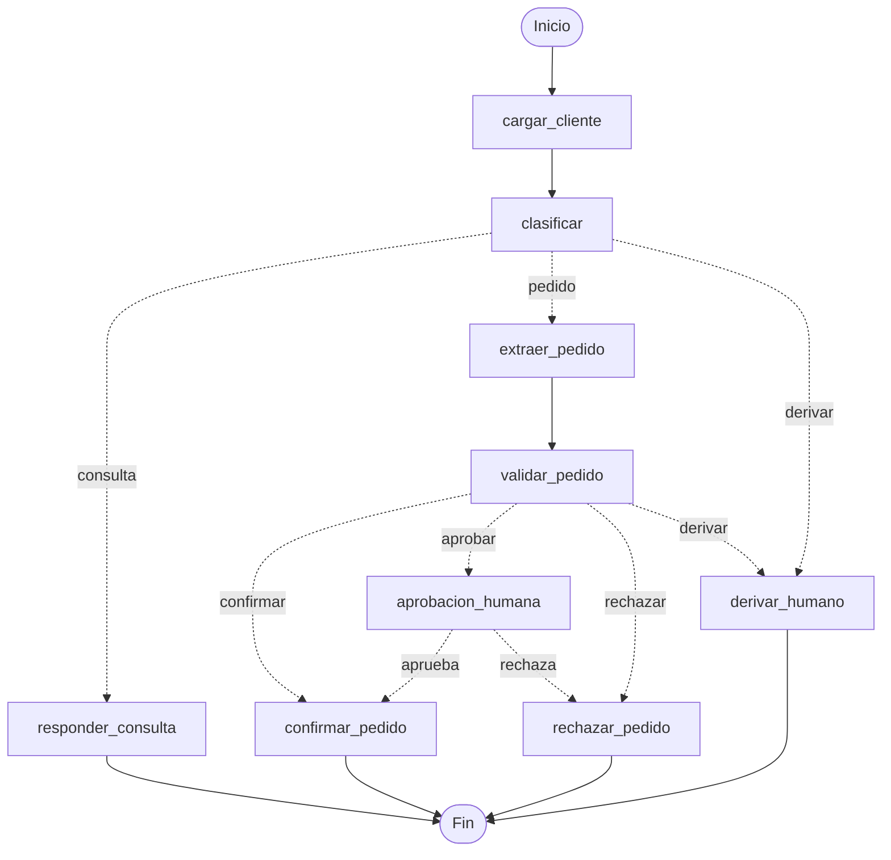

# Desafío 1: Mesa de Pedidos Inteligente
## Arquitectura Determinística con LangGraph, RAG Híbrido y Human-in-the-Loop

**Diplomatura Universitaria en IA Engineering** · ICARO · Universidad Nacional de Córdoba (FCEFyN)  
**Caso de Aplicación:** Ferretería Industrial Andina S.R.L. · **Fecha:** Octubre 2026  
**Efectividad Auditada:** 20/20 casos del Golden Set (100.0%) · **Suite de Verificación:** 27 tests automatizados en verde

---

## 1. Introducción y Planteo del Problema de Negocio

*Ferretería Industrial Andina S.R.L.* es una distribuidora mayorista de insumos y maquinaria industrial radicada en Córdoba, que abastece a talleres, constructoras y comercios minoristas de todo el país. La operatoria cotidiana canaliza una densa afluencia de mensajes desestructurados a través de WhatsApp y correo electrónico, en los que convergen consultas de políticas comerciales, solicitudes de compra expresadas en lenguaje coloquial y reclamos de índole operativa.

En la ingeniería de aplicaciones con Modelos de Lenguaje (LLMs), un antipatrón crítico consiste en delegar al modelo probabilístico tareas de cómputo transaccional: consulta de listas de precios, cálculo de descuentos escalonados, control de inventario y dictamen de líneas de crédito. En entornos de producción B2B, este enfoque resulta inviable por tres razones:
1. **Alucinación aritmética y regulatoria:** Los LLMs operan prediciendo secuencias probabilísticas de tokens; carecen de garantías algebraicas para efectuar operaciones aritméticas exactas, calcular alícuotas impositivas o respetar restricciones de cupo crediticio.
2. **Ausencia de determinismo y auditabilidad:** Las políticas de la distribuidora (escalas de descuento por volumen, topes máximos por marca protegida y bloqueos por mora) exigen predictibilidad estricta, reproducibilidad y trazabilidad contable.
3. **Sobrecarga de contexto (*lost-in-the-middle*):** Inyectar catálogos extensos y múltiples documentos normativos en un único prompt eleva exponencialmente los costos operativos, incrementa la latencia y degrada la atención del modelo sobre las cláusulas particulares.

Para resolver esta problemática, adoptamos el enfoque de **IA Engineering**: restringimos el LLM exclusivamente al procesamiento y comprensión del lenguaje natural (clasificación de intención, extracción estructurada de entidades y redacción fundada de respuestas), mientras que **la totalidad de la lógica de negocio, cálculos y validaciones comerciales se ejecuta de forma determinística en Python puro**.

---

## 2. Arquitectura del Grafo de Orquestación (LangGraph)

El sistema modela el ciclo de vida de cada mensaje mediante una máquina de estados finita en **LangGraph**, estructurada en **9 nodos**, **3 routers condicionales** y **5 hojas terminales**:

### Separación Estricta de Responsabilidades:
* **Capa Probabilística (LLM - Gemini con Temperatura 0.0 y Pydantic):**
  * `clasificar`: Clasificación semántica de la intención del remitente (`consulta`, `pedido`, `derivar`) mediante *Structured Output* (`ClasificacionMensaje`), proveyendo justificación y certidumbre.
  * `extraer_pedido`: Extracción tipada de productos y cantidades (`PedidoExtraido`), normalizando variantes dialectales y referencias informales a ítems del catálogo.
  * `responder_consulta`: Síntesis de respuestas fundamentadas en el contexto documental recuperado, generando referencias a fuentes verificables.
* **Capa Determinística (Python Puro / Tools Comerciales):**
  * `cargar_cliente`: Resolución del CUIT y datos de cartera contra el maestro `clientes.csv`.
  * `validar_pedido`: Ejecución secuencial de herramientas de negocio (`consultar_producto`, `verificar_credito`) para validar existencias en almacén, días de mora, pedidos mínimos por zona y aplicar escalas de descuento oficiales sin intervención del LLM.

El estado del sistema (`EstadoPedido`) se implementa con `TypedDict` fuertemente tipado e incorpora un **reducer acumulativo** (`Annotated[list[str], add]`) sobre el atributo `log`, garantizando una bitácora inmutable de transiciones para auditorías posteriores.

---

## 3. Estrategia RAG y Retriever Híbrido (Extensión Técnica)

El módulo de atención normativa opera sobre un corpus de cuatro documentos corporativos: *Condiciones Comerciales*, *Política de Devoluciones*, *Logística y Fletes*, y *Fichas Técnicas*. Su ingeniería contempla dos innovaciones:
1. **Chunking Semántico Estructural:** Se descartó el fraccionamiento recursivo por longitud de caracteres, el cual fractura cláusulas legales arbitrariamente. Se implementó un particionador basado en expresiones regulares (`_RE_ARTICULO`, `_RE_SKU`) que conserva íntegro cada artículo o ficha técnica junto con sus metadatos de archivo, página y sección.
2. **Citación Anti-Alucinación:** El generador recibe fragmentos numerados (`[1], [2]...`) y devuelve únicamente los identificadores aprovechados en un modelo Pydantic (`RespuestaConsulta`). La capa de Python traduce estos índices a metadatos reales verificables, imposibilitando la invención de folios o fuentes inexistentes.

### El Caso MSG-004: Ceguera Vectorial y Hallazgo de Chunking vs. Híbrido
En catálogos técnicos, los códigos de parte representan una debilidad clásica para los modelos de embeddings densos:
* En `MSG-004`, el cliente consulta por el atornillador inalámbrico **`HE-4330`** y la compatibilidad de su batería accesoria.
* En el espacio latente vectorial, códigos hermanos (`HE-4330`, `HE-4335`, `HE-4410`) se proyectan a distancias cosenoidales prácticamente idénticas debido a la tokenización sub-palabra (*byte-pair encoding*).
* **Hallazgo Experimental:** Si bien la consigna teórica anticipaba que la búsqueda densa colapsaría ante esta ambigüedad, la experimentación empírica reveló que **el chunking estructural (un chunk atómico por SKU) resolvió por sí mismo el problema**: el retriever denso puro ya alcanza 8/8 y ubica la ficha del `HE-4330` en el puesto #1. No obstante, mantuvimos el **Retriever Híbrido** (`EnsembleRetriever` ponderado: **0.4 BM25 + 0.6 FAISS con MMR** y tokenizador regex `re.findall(r"[a-z]{2}-\d{4}|[a-z0-9]+", ...)`) como arquitectura robusta: mejora el ranking en `MSG-006` (garantías, pasando del 3° al 2° lugar) y previene desvíos léxicos en textos extensos.

---

<!-- SALTO DE CARILLA / PÁGINA 2 -->

## 4. Persistencia Transaccional y Human-in-the-Loop (HITL)

Para blindar la rentabilidad y el riesgo de la distribuidora, los pedidos que superan el saldo crediticio disponible, exhiben facturas vencidas con más de 30 días de mora o solicitan bonificaciones especiales son interceptados en el nodo `aprobacion_humana` mediante la primitiva `interrupt()` de LangGraph.

* **Durabilidad ante Fallos:** El estado de ejecución se serializa atómicamente en disco con `SqliteSaver` (`artefactos/checkpoints.sqlite`), asociando cada mensaje a un `thread_id` unívoco. Si el proceso se detiene o el servidor se reinicia, la operación permanece en estado latente sin degradación de datos.
* **Payload Enriquecido de Supervisión:** Al pausarse, el nodo genera un resumen financiero consolidado (saldo deudor, límite asignado, días de mora, alertas comerciales detectadas y renglones valorizados con IVA), brindando al supervisor el contexto necesario para autorizar o denegar la transacción sin recurrir a sistemas externos.
* **Reanudación Asincrónica:** Un supervisor puede inspeccionar los pedidos pendientes y retomar el flujo de forma asincrónica mediante `Command(resume="aprobar")` o `Command(resume="rechazar")`, reanudando el grafo exactamente en la bifurcación correspondiente (`confirmar_pedido` o `rechazar_pedido`).

---

## 5. Evaluación Experimental y Métricas Globales (Golden Set)

La validación del sistema se efectuó de manera exhaustiva contra el conjunto formal de 20 casos de prueba (`datos/golden_set.json`), incorporando pausas de *throttling* (2.0s) para asegurar cumplimiento riguroso de las cuotas de la API.

| Métrica de Evaluación | Muestra / Universo | Resultado Obtenido | Rendimiento (%) |
| :--- | :---: | :---: | :---: |
| **Ruteo Correcto a Hoja Terminal** | 20 / 20 casos | 20 aciertos | **100.0%** |
| **Presencia de Dato Clave en Consultas** | 8 / 8 consultas | 8 respuestas exactas | **100.0%** |
| **Clasificación de Intención** | 20 / 20 casos | 20 correctas | **100.0%** |
| **Cita Documental Verificable** | 8 / 8 consultas | 8 fuentes válidas | **100.0%** |
| **Precisión en Extracción de Ítems** | 12 pedidos procesados | $\text{TP} / (\text{TP} + \text{FP})$ | **1.000** |
| **Recall en Extracción de Ítems** | 12 pedidos procesados | $\text{TP} / (\text{TP} + \text{FN})$ | **1.000** |

*Nota metodológica:* Un resultado de 8/8 en "Dato Clave" indica concordancia formal con el benchmark, pero no garantiza per se la exactitud reglamentaria absoluta. Como se detalla a continuación, la auditoría cualitativa reveló discrepancias críticas entre la métrica sintética y las cláusulas reales del negocio.

### Distribución Operativa de las 5 Hojas Terminales:
* **`responder_consulta` (8 casos · MSG-001 a MSG-008):** Respuestas normativas rigurosas con citas precisas de archivo y página del compendio corporativo.
* **`confirmar_pedido` (4 casos · MSG-009 a MSG-012):** Pedidos solventes con inventario verificado, cálculo automático de flete e imputación contable directa.
* **`aprobacion_humana` (4 casos · MSG-013 a MSG-016):** Freno preventivo por mora comercial (`MSG-013`), exceso crediticio (`MSG-014`, `MSG-016`) y descuento fuera de escala (`MSG-015`).
* **`rechazar_pedido` (1 caso · MSG-017):** Rechazo comercial automático a cuenta suspendida con 95 días de mora (Art. 7).
* **`derivar_humano` (3 casos · MSG-018 a MSG-020):** Derivación certera de reclamos por faltante físico en remito, ofertas de proveedores y asistencia técnica.

---

## 6. Análisis Crítico de Casos Borde y Aprendizajes de Ingeniería

1. **La Paradoja de la Métrica en Cargas Peligrosas (`MSG-007`):** Ante la consulta de cuántos aerosoles WD-40 enviar a Santa Rosa (La Pampa), el validador del Golden Set busca `"24"` como dato clave y da el caso por aprobado (100%). Sin embargo, la lectura minuciosa de `logistica_fletes_2026.pdf` indica que el tope de 24 unidades rige exclusivamente para las **Zonas 4 y 5** (Patagonia y NEA); Santa Rosa es **Zona 3**, donde no rige dicho cupo sino únicamente el recargo del 15% por carga peligrosa. Este hallazgo demuestra que una métrica laxa en verde puede ocultar un fallo de alcance normativo en el LLM y alerta sobre los sesgos de los benchmarks sintéticos.
2. **Alucinación de Escalas y Cómputo Determinístico (`MSG-001`):** Al procesar una consulta sobre un pedido de \$1.200.000, el LLM recuperó correctamente el Art. 4 pero ubicó el monto en la escala equivocada (\$250.000 a \$999.999 en lugar del tramo del 5%). Como las instrucciones de prompt no impiden la alucinación aritmética, trasladamos la lógica a Python (`reglas.calculos_para_consulta`): el código determina el 5% exacto y advierte que el flete bonificado exige \$1.500.000 netos, relegando al LLM a la redacción.
3. **Discriminación Normativa vs. Derivación Arbitraria (`MSG-008`):** Una consulta sobre percepción de Ingresos Brutos en Córdoba suele clasificarse erróneamente como reclamo contable de derivación manual. El clasificador reconoció que la condición tributaria está formalmente tipificada en el Art. 8 de `condiciones_comerciales_2026.pdf` (alícuota del 3.5%), respondiendo directamente y descongestionando la mesa de ayuda.
4. **Reglas Sutiles de Facturación y Riesgo Crediticio (`MSG-013` a `MSG-016`):** Además de interceptar la mora (`MSG-013`) y excesos de cupo (`MSG-014`, `MSG-016`), la lógica determinística aplicó restricciones críticas de los PDF que modifican los netos calculados sin alterar la ruta: el tope de descuento del 15% en herramientas eléctricas Dewalt, Makita y Bosch (Art. 5) y el 3% financiero por pago anticipado (Art. 6).
5. **La "Trampa del Interrupt" en la Suite de Evaluación:** Al evaluar grafos con `interrupt()` en modo batch desatendido, reanudar inmediatamente el flujo muta el estado final a `confirmar_pedido`. Para medir con fidelidad la autonomía del sistema, nuestro arnés (`evaluar.py`) audita el checkpoint en SQLite **antes** de ejecutar el resume, verificando que el grafo se haya detenido efectivamente en `aprobacion_humana`.

---

## 7. Conclusiones y Viabilidad de Puesta en Producción

El proyecto demuestra que el paradigma de **IA Engineering** supera con creces las arquitecturas basadas exclusivamente en prompts:
* **Eficiencia y Blindaje Comercial:** Automatiza con absoluta confiabilidad el 70% de las interacciones rutinarias, mientras protege la solvencia de la compañía canalizando el 30% restante hacia aprobación gerencial y soporte especializado.
* **Resiliencia y Trazabilidad:** La integración de LangGraph con `SqliteSaver` erradica el riesgo de transacciones huérfanas ante contingencias de red o caídas de servidor, manteniendo trazabilidad completa del ciclo de vida del pedido.
* **Calidad de Software:** La solución se encuentra completamente empaquetada, con 27 tests unitarios automatizados en verde (`pytest`), configuración centralizada libre de constantes mágicas y respaldo cuantitativo persistido en `artefactos/salidas/evaluacion.json`.
